# ERD — Gym Management System

**Status:** Logical model (Phase 2, documentation only — no schema exists yet). Model-class names are shown as entities; Django will generate physical tables (`<app>_<model>`) in a later phase. Attribute lists are summarized (types/constraints are normative in [`database-design.md`](database-design.md)).

Mermaid notation: `||` exactly one · `|o` zero or one · `o{` zero or more. A dashed meaning is not used; every edge below maps to a foreign key listed in §2.

---

## 1. Full ER Diagram

```mermaid
erDiagram
    ROLE {
        bigint id PK
        varchar code UK
        varchar name
        text description
    }
    USER {
        bigint id PK
        varchar username UK
        varchar password
        varchar email
        bigint role_id FK
        boolean is_active
        timestamptz last_login
    }
    MEMBER {
        bigint id PK
        varchar gym_member_id UK
        varchar full_name
        varchar gender
        date date_of_birth
        varchar phone UK
        text address
        varchar email UK
        varchar photo
        varchar emergency_contact_name
        varchar emergency_contact_phone
        date registration_date
    }
    MEMBERSHIP_PLAN {
        bigint id PK
        varchar code UK
        varchar name
        int duration_count
        varchar duration_unit
        numeric price
        boolean is_active
    }
    MEMBERSHIP {
        bigint id PK
        bigint member_id FK
        bigint plan_id FK
        numeric agreed_price
        date start_date
        date end_date
        varchar status
    }
    PAYMENT {
        bigint id PK
        bigint membership_id FK
        numeric amount
        varchar method
        varchar status
        timestamptz paid_at
        bigint received_by_id FK
        text note
    }
    RECEIPT {
        bigint id PK
        bigint payment_id FK
        varchar receipt_number UK
        timestamptz issued_at
        bigint issued_by_id FK
    }
    ATTENDANCE_SESSION {
        bigint id PK
        bigint member_id FK
        timestamptz check_in_at
        varchar check_in_method
        timestamptz check_out_at
        varchar check_out_method
        bigint recorded_by_id FK
        text manual_reason
    }
    BIOMETRIC_DEVICE {
        bigint id PK
        varchar label
        varchar vendor_name
        varchar model_name
        varchar modality
        boolean is_active
    }
    BIOMETRIC_ENROLLMENT {
        bigint id PK
        bigint member_id FK
        bigint device_id FK
        varchar modality
        varchar template_ref
        varchar status
        bigint enrolled_by_id FK
        timestamptz enrolled_at
    }
    ACCESS_DEVICE {
        bigint id PK
        varchar label
        varchar kind
        bigint biometric_device_id FK
        boolean is_active
    }
    ACCESS_ATTEMPT {
        bigint id PK
        timestamptz occurred_at
        bigint member_id FK
        bigint biometric_device_id FK
        bigint access_device_id FK
        varchar modality
        varchar verification_result
        varchar decision
        varchar deny_reason
        bigint override_by_id FK
        text override_reason
    }
    TRAINER_PROFILE {
        bigint id PK
        bigint user_id FK
        varchar specialization
        text bio
        boolean is_accepting_members
    }
    TRAINER_ASSIGNMENT {
        bigint id PK
        bigint member_id FK
        bigint trainer_id FK
        bigint assigned_by_id FK
        timestamptz assigned_at
        timestamptz unassigned_at
        varchar end_reason
    }
    WORKOUT_PLAN {
        bigint id PK
        bigint member_id FK
        bigint created_by_id FK
        varchar title
        date start_date
        date end_date
        boolean is_active
    }
    EXERCISE {
        bigint id PK
        varchar name UK
        text description
    }
    WORKOUT_PLAN_EXERCISE {
        bigint id PK
        bigint workout_plan_id FK
        bigint exercise_id FK
        varchar day_of_week
        varchar sets
        varchar reps
        text guidance
        int order
    }
    TRAINING_SCHEDULE {
        bigint id PK
        bigint trainer_id FK
        bigint member_id FK
        bigint workout_plan_id FK
        varchar day_of_week
        time start_time
        time end_time
        boolean is_active
    }
    EQUIPMENT_CATEGORY {
        bigint id PK
        varchar name UK
        text description
    }
    EQUIPMENT {
        bigint id PK
        bigint category_id FK
        varchar name
        varchar asset_tag UK
        varchar serial_number UK
        int quantity
        date purchase_date
        numeric purchase_cost
        varchar status
        boolean is_serialized
    }
    MAINTENANCE_RECORD {
        bigint id PK
        bigint equipment_id FK
        varchar type
        varchar status
        date scheduled_date
        date performed_date
        numeric cost
        varchar performed_by
        text description
    }
    EXPENSE_CATEGORY {
        bigint id PK
        varchar code UK
        varchar name
        text description
    }
    EXPENSE {
        bigint id PK
        bigint category_id FK
        bigint recorded_by_id FK
        numeric amount
        date expense_date
        text description
        varchar attachment
        varchar status
    }
    EXPENSE_APPROVAL {
        bigint id PK
        bigint expense_id FK
        bigint decided_by_id FK
        varchar decision
        text reason
        timestamptz decided_at
    }
    NOTIFICATION {
        bigint id PK
        varchar event_type
        bigint recipient_user_id FK
        bigint recipient_member_id FK
        varchar title
        text body
        timestamptz created_at
    }
    NOTIFICATION_DELIVERY {
        bigint id PK
        bigint notification_id FK
        varchar channel
        varchar status
        int attempts
        timestamptz sent_at
        text error_message
        varchar provider_ref
    }
    AUDIT_LOG {
        bigint id PK
        timestamptz occurred_at
        bigint actor_id FK
        varchar event_type
        varchar object_type
        varchar object_id
        jsonb context
        inet ip_address
    }

    ROLE ||--o{ USER : "assigned role"
    USER |o--o| TRAINER_PROFILE : "trainer profile (trainers only)"
    MEMBER ||--o{ MEMBERSHIP : "membership history"
    MEMBERSHIP_PLAN ||--o{ MEMBERSHIP : "plan"
    MEMBERSHIP ||--o{ PAYMENT : "payments"
    PAYMENT ||--o| RECEIPT : "receipted as"
    USER ||--o{ PAYMENT : "received_by"
    USER ||--o{ RECEIPT : "issued_by"
    MEMBER ||--o{ ATTENDANCE_SESSION : "visits"
    USER |o--o{ ATTENDANCE_SESSION : "recorded_by (manual ops)"
    MEMBER ||--o{ BIOMETRIC_ENROLLMENT : "enrolled identities"
    BIOMETRIC_DEVICE ||--o{ BIOMETRIC_ENROLLMENT : "template home device"
    USER ||--o{ BIOMETRIC_ENROLLMENT : "enrolled_by"
    MEMBER |o--o{ ACCESS_ATTEMPT : "subject (null = unknown identity)"
    BIOMETRIC_DEVICE ||--o{ ACCESS_ATTEMPT : "verified on"
    ACCESS_DEVICE |o--o{ ACCESS_ATTEMPT : "door decision context"
    USER |o--o{ ACCESS_ATTEMPT : "override_by"
    ACCESS_DEVICE |o--o| BIOMETRIC_DEVICE : "optional paired terminal"
    MEMBER ||--o{ TRAINER_ASSIGNMENT : "assignments"
    USER ||--o{ TRAINER_ASSIGNMENT : "trainer"
    USER ||--o{ TRAINER_ASSIGNMENT : "assigned_by"
    MEMBER ||--o{ WORKOUT_PLAN : "plans for"
    USER ||--o{ WORKOUT_PLAN : "created_by"
    WORKOUT_PLAN ||--o{ WORKOUT_PLAN_EXERCISE : "includes"
    EXERCISE ||--o{ WORKOUT_PLAN_EXERCISE : "used in"
    USER ||--o{ TRAINING_SCHEDULE : "trainer"
    MEMBER ||--o{ TRAINING_SCHEDULE : "scheduled"
    WORKOUT_PLAN |o--o{ TRAINING_SCHEDULE : "plan context"
    EQUIPMENT_CATEGORY ||--o{ EQUIPMENT : "categorizes"
    EQUIPMENT ||--o{ MAINTENANCE_RECORD : "service history"
    EXPENSE_CATEGORY ||--o{ EXPENSE : "categorizes"
    USER ||--o{ EXPENSE : "recorded_by"
    EXPENSE ||--o{ EXPENSE_APPROVAL : "decision history"
    USER ||--o{ EXPENSE_APPROVAL : "decided_by"
    USER |o--o{ NOTIFICATION : "recipient_user (in-app)"
    MEMBER |o--o{ NOTIFICATION : "recipient_member (SMS/email)"
    NOTIFICATION ||--o{ NOTIFICATION_DELIVERY : "channel deliveries"
    USER |o--o{ AUDIT_LOG : "actor (null = SYSTEM)"
```

## 2. Relationship -> FK Dictionary

| Edge | FK field | On-target entity | Null? | on_delete plan |
|---|---|---|---|---|
| ROLE -> USER | `User.role_id` | User | No | PROTECT |
| USER -> TRAINER_PROFILE | `TrainerProfile.user_id` | User (role TRAINER) | No | CASCADE (profile extension) |
| MEMBER -> MEMBERSHIP | `Membership.member_id` | Member | No | PROTECT |
| MEMBERSHIP_PLAN -> MEMBERSHIP | `Membership.plan_id` | MembershipPlan | No | PROTECT |
| MEMBERSHIP -> PAYMENT | `Payment.membership_id` | Membership | No | PROTECT |
| PAYMENT -> RECEIPT | `Receipt.payment_id` (OneToOne) | Payment | No | CASCADE |
| USER -> PAYMENT | `Payment.received_by_id` | User | No | PROTECT |
| USER -> RECEIPT | `Receipt.issued_by_id` | User | No | PROTECT |
| MEMBER -> ATTENDANCE_SESSION | `AttendanceSession.member_id` | Member | No | PROTECT |
| USER -> ATTENDANCE_SESSION | `AttendanceSession.recorded_by_id` | User (manual) | **Yes** | SET_NULL |
| MEMBER -> BIOMETRIC_ENROLLMENT | `BiometricEnrollment.member_id` | Member | No | PROTECT |
| BIOMETRIC_DEVICE -> BIOMETRIC_ENROLLMENT | `BiometricEnrollment.device_id` | BiometricDevice | No | PROTECT |
| USER -> BIOMETRIC_ENROLLMENT | `BiometricEnrollment.enrolled_by_id` | User | No | PROTECT |
| MEMBER -> ACCESS_ATTEMPT | `AccessAttempt.member_id` | Member | **Yes** (unknown identity) | SET_NULL |
| BIOMETRIC_DEVICE -> ACCESS_ATTEMPT | `AccessAttempt.biometric_device_id` | BiometricDevice | No | PROTECT |
| ACCESS_DEVICE -> ACCESS_ATTEMPT | `AccessAttempt.access_device_id` | AccessDevice | **Yes** (verification w/o door) | SET_NULL |
| USER -> ACCESS_ATTEMPT | `AccessAttempt.override_by_id` | User | **Yes** | SET_NULL |
| ACCESS_DEVICE -> BIOMETRIC_DEVICE | `AccessDevice.biometric_device_id` | BiometricDevice | **Yes** (pairing optional) | SET_NULL |
| MEMBER -> TRAINER_ASSIGNMENT | `TrainerAssignment.member_id` | Member | No | PROTECT |
| USER -> TRAINER_ASSIGNMENT | `TrainerAssignment.trainer_id` | User (role TRAINER) | No | PROTECT |
| USER -> TRAINER_ASSIGNMENT | `TrainerAssignment.assigned_by_id` | User (ADMIN) | No | PROTECT |
| MEMBER -> WORKOUT_PLAN | `WorkoutPlan.member_id` | Member | No | PROTECT |
| USER -> WORKOUT_PLAN | `WorkoutPlan.created_by_id` | User (TRAINER) | No | PROTECT |
| WORKOUT_PLAN -> WORKOUT_PLAN_EXERCISE | `WorkoutPlanExercise.workout_plan_id` | WorkoutPlan | No | CASCADE |
| EXERCISE -> WORKOUT_PLAN_EXERCISE | `WorkoutPlanExercise.exercise_id` | Exercise | No | PROTECT |
| USER -> TRAINING_SCHEDULE | `TrainingSchedule.trainer_id` | User | No | PROTECT |
| MEMBER -> TRAINING_SCHEDULE | `TrainingSchedule.member_id` | Member | No | PROTECT |
| WORKOUT_PLAN -> TRAINING_SCHEDULE | `TrainingSchedule.workout_plan_id` | WorkoutPlan | **Yes** | SET_NULL |
| EQUIPMENT_CATEGORY -> EQUIPMENT | `Equipment.category_id` | EquipmentCategory | No | PROTECT |
| EQUIPMENT -> MAINTENANCE_RECORD | `MaintenanceRecord.equipment_id` | Equipment | No | PROTECT |
| EXPENSE_CATEGORY -> EXPENSE | `Expense.category_id` | ExpenseCategory | No | PROTECT |
| USER -> EXPENSE | `Expense.recorded_by_id` | User | No | PROTECT |
| EXPENSE -> EXPENSE_APPROVAL | `ExpenseApproval.expense_id` | Expense | No | PROTECT |
| USER -> EXPENSE_APPROVAL | `ExpenseApproval.decided_by_id` | User | No | PROTECT |
| USER -> NOTIFICATION | `Notification.recipient_user_id` | User | **Yes** | SET_NULL |
| MEMBER -> NOTIFICATION | `Notification.recipient_member_id` | Member | **Yes** | SET_NULL |
| NOTIFICATION -> NOTIFICATION_DELIVERY | `NotificationDelivery.notification_id` | Notification | No | CASCADE |
| USER -> AUDIT_LOG | `AuditLog.actor_id` | User | **Yes** (SYSTEM) | SET_NULL |

Note: there is intentionally **no User-Member FK** in the diagram — staff identities are not member identities (AD-02); the domains connect through domain entities (memberships, payments, assignments, etc.) only.

## 3. Cardinality Notes Justifying the Model

1. **Member 1:N Membership** — multiple historical memberships preserved; renewal creates a new row (BR-MEM-08/09).
2. **Membership 1:N Payment** — full and partial payments accumulate per membership; outstanding balance derived (BR-MEM-07).
3. **Payment 0..1 Receipt** — one receipt per completed payment, generated after recording.
4. **AttendanceSession** internal 0..1/1 symmetry — check-out nullable until exit; unique open-session guard (BR-ATT-01).
5. **Member 0..N AccessAttempt vs Member 0..N AttendanceSession** separation — denied access never creates attendance (confirmed requirement: attempts separate from sessions).
6. **TrainerAssignment history 0..N rows per member** — each assignment change appends (BR-TRN-02/06).
7. **Expense 1:N ExpenseApproval** — approval/rejection cycles accumulate; latest row governs (BR-EXP-02/05).
8. **Notification 1:N NotificationDelivery** — per-channel outcome tracking (BR-NTF-03).
9. **BiometricEnrollment** — the member <-> device/modality/template mapping with revocation; multiple devices supported (BR-BIO-04).
10. **AuditLog** — polymorphic target with null-able SYSTEM actor (BR-AUD-04).
